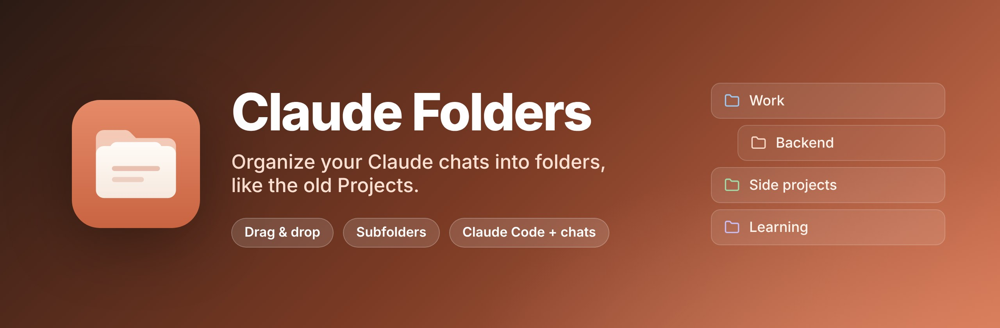
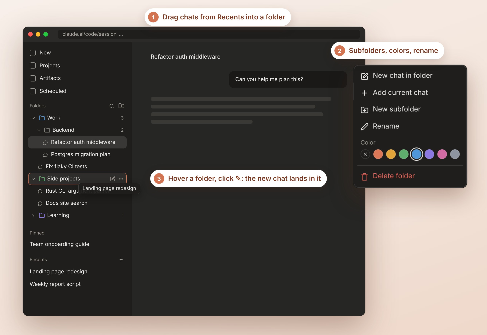
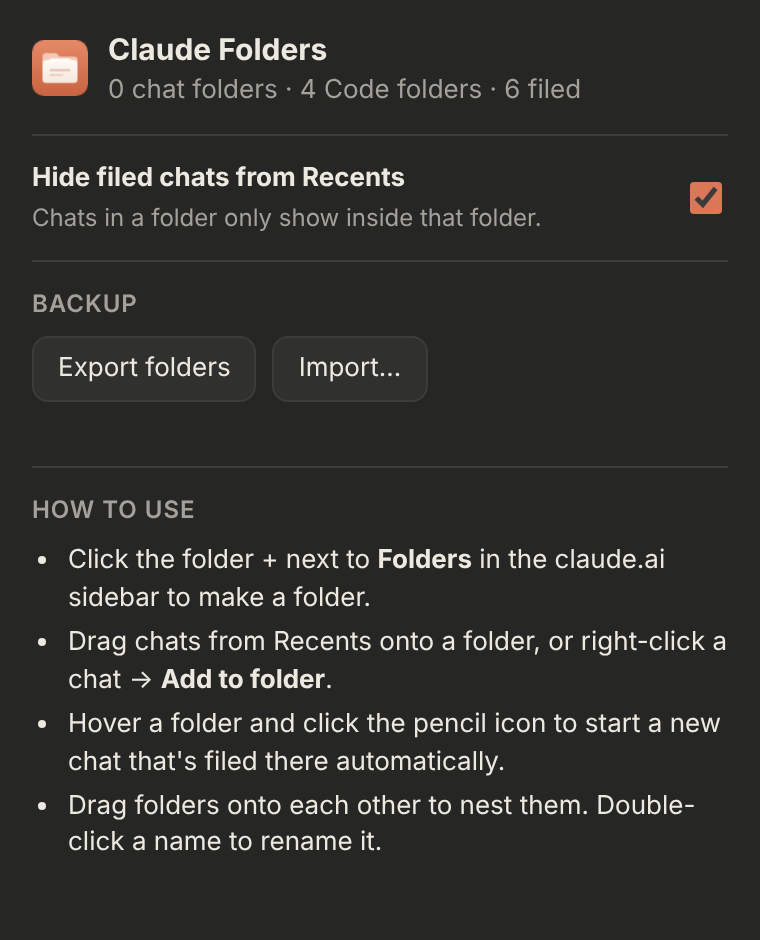
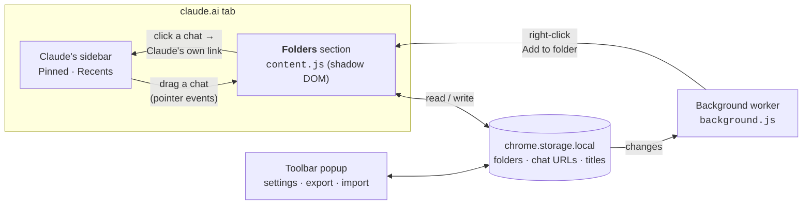

<p align="center">
  
</p>

<p align="center">
  <a href="https://github.com/TingGeorge/old-web-claude-project-feature-chrome-extension/releases/latest"></a>
  <a href="https://github.com/TingGeorge/old-web-claude-project-feature-chrome-extension/actions/workflows/release.yml"></a>
  
  
  <a href="LICENSE"></a>
</p>

<p align="center">
  <b>The old Claude Projects let you drop chats into folders. The new Projects do a lot more, and sometimes you just want the folders.</b><br>
  This extension adds a <b>Folders</b> section to the claude.ai sidebar, for both regular chats and Claude Code sessions.<br>
  Drag chats in, nest folders, color them, and start new chats right inside a folder.
</p>

<p align="center">
  <a href="#-install"><b>Install</b></a> ·
  <a href="#-how-to-use"><b>How to use</b></a> ·
  <a href="#-how-it-works"><b>How it works</b></a> ·
  <a href="#-troubleshooting"><b>Troubleshooting</b></a> ·
  <a href="#-development"><b>Development</b></a>
</p>

---

<p align="center">
  
</p>
<p align="center"><sub>The extension running on a stand-in for the claude.ai sidebar (the page used by the automated tests).</sub></p>

## ✨ Features

| | |
| --- | --- |
| 📁 **Folders in the sidebar** | A **Folders** section above Pinned/Starred and Recents, styled to match Claude's own sidebar in light and dark mode. |
| 🖱️ **Drag and drop** | Drag a chat from Recents or Pinned onto a folder. Drag chats between folders, or drop one on another chat to put it right above it. |
| 🗂️ **Subfolders** | Drag a folder onto another folder to nest it, or use ⋯ → *New subfolder*. Drop a folder on the top edge of another to reorder instead. |
| ✏️ **New chat in a folder** | Hover a folder and click ✎. The next chat you start is filed into that folder automatically, like starting a chat inside an old Project. |
| 🧹 **Tidy Recents** | Chats in a folder are hidden from Recents, so Recents only shows what you haven't organized yet. You can turn this off. |
| 🎨 **Colors** | Give each folder one of eight colors from its ⋯ menu. |
| 🔍 **Search** | Filter folders and chats by name from the 🔍 button next to *Folders*. |
| 🖱️ **Right-click menu** | Right-click any chat link on claude.ai → **Add to folder**. |
| 💻 **Chats and Claude Code** | Works on regular chats (`claude.ai/chat`) and Claude Code sessions (`claude.ai/code`). Each has its own folders. |
| 💾 **Backup** | Export your folders to a JSON file and import them again, on this computer or another one. |
| 🔒 **Private** | No network requests, no analytics. Folders are stored only in your browser, and the extension never reads your messages. |

## 🚀 Install

### Option A: Download a release (recommended)

1. Download **`claude-folders-vX.Y.Z.zip`** from the [latest release](https://github.com/TingGeorge/old-web-claude-project-feature-chrome-extension/releases/latest) and unzip it.
2. Open `chrome://extensions` and turn on **Developer mode** (top right).
3. Click **Load unpacked** and choose the unzipped **`claude-folders`** folder.
4. Open or reload [claude.ai](https://claude.ai). A **Folders** section appears in the sidebar.

Keep the `claude-folders` folder somewhere permanent (not Downloads), because Chrome loads the extension from it.

### Option B: From source

```sh
git clone https://github.com/TingGeorge/old-web-claude-project-feature-chrome-extension.git
```

Then follow steps 2–4 above, choosing the **`extension`** folder inside the clone.

Other Chromium browsers (Edge, Brave, Arc, Vivaldi) load it the same way from their extensions page.

## 📖 How to use



- **Make a folder:** click the folder-plus icon next to **Folders**, type a name and press <kbd>Return</kbd>.
- **File a chat:** drag it from Recents onto a folder, or right-click it → **Add to folder**. To file the chat you have open, use the folder's ⋯ → **Add current chat**.
- **Start a chat inside a folder:** hover the folder and click ✎. A banner shows where the next chat will go. Click ✕ on the banner to cancel.
- **Nest and reorder:** drag a folder onto another to nest it. Drop it on the top edge of a folder to put it before that folder instead, or on the **Folders** heading to move it back to the top level.
- **Rename:** double-click a folder or chat name. Clear a chat's name to go back to Claude's title.
- **Remove a chat from a folder:** hover it and click ✕. The chat goes back to Recents. Nothing is deleted from Claude.
- **Delete a folder:** ⋯ → **Delete folder**. Its chats go back to Recents; the chats themselves are never deleted.
- **Settings and backup:** click the extension's toolbar icon. You can turn hiding filed chats in Recents on or off, and export or import your folders.

<br clear="right">

## 🧠 How it works

The extension is a content script on `claude.ai` plus a small background worker. It doesn't call any Claude API; it only rearranges what your browser shows.



- **Finding the sidebar.** It looks for the *Pinned*, *Starred* or *Recents* heading and inserts the Folders section above it. If the sidebar is collapsed or can't be found, a small floating folder button appears at the bottom-left instead.
- **What's stored.** Each folder keeps the URLs of its chats (`/chat/<id>` or `/code/session_<id>`) and a title for display. Titles update on their own when Claude renames a chat, unless you renamed it yourself.
- **Opening a chat** clicks Claude's own sidebar link for it, so navigation stays inside the app without a page reload.
- **Hiding from Recents** only adds a `display: none` style in your tab. Claude's data isn't touched; disable or remove the extension and everything shows again.
- **Dragging** follows the mouse with pointer events rather than the browser's built-in drag and drop, so it keeps working however claude.ai handles drag events on its own page.
- **Isolated UI.** The Folders section lives in a shadow root, so claude.ai's styles can't break it and its styles can't leak into claude.ai. It copies colors and fonts from Claude's sidebar so it blends in.

## 🛡️ Privacy & permissions

- **`storage`**: saves your folders in your browser (`chrome.storage.local`).
- **`contextMenus`**: adds *Add to folder* to the right-click menu on chat links.
- **Runs only on `https://claude.ai/*`.** It has no access to other sites or your browsing history.
- **No network requests, no analytics, no tracking.** It never reads your messages, only the chat titles and links in the sidebar.
- **Your chats are safe.** The extension can't create, delete, rename or move anything in your Claude account. Uninstalling it leaves claude.ai exactly as it was.

## 🩺 Troubleshooting

| Symptom | Fix |
| --- | --- |
| No **Folders** section | Reload the claude.ai tab after installing or updating. If the sidebar is collapsed, use the floating folder button at the bottom-left. |
| Folders appear twice | Two copies of the extension are loaded. Remove the older one in `chrome://extensions`. |
| A chat won't drop into a folder | Drop it onto a folder's row (it gets an outline) or onto a chat inside the folder. Chats from Claude Code and regular chats can only go into folders of the same kind. |
| A chat is missing from Recents | It's in a folder. Turn off **Hide filed chats from Recents** in the toolbar popup to see it in both places. |
| Chat titles look out of date | Titles refresh when the chat appears in Claude's sidebar. Scroll Recents, or double-click the name to rename it yourself. |
| It stopped working after a claude.ai update | claude.ai may have changed its sidebar. Please [open an issue](https://github.com/TingGeorge/old-web-claude-project-feature-chrome-extension/issues) with a screenshot. |

### Updating

Unpacked extensions don't update themselves. To move to a new release:

1. Click the extension's toolbar icon → **Export folders** to save a backup.
2. Download and unzip the new release.
3. Copy the new files over your old `claude-folders` folder, then click ↻ **Reload** on the extension in `chrome://extensions` and reload claude.ai. Your folders stay.

If you cloned the repo instead: `git pull`, then click ↻ **Reload**.

> **Upgrading from 1.0.x?** In 1.1.0 the extension moved into the `extension/` folder and got a fixed ID (`bcfdblekpgeicllfhafboehamjjpgenm`), so Chrome treats it as a new extension. Before upgrading, **export your folders** from the old version. Then remove the old version, load the new one, and **import** the backup.

### Uninstall

Remove **Claude Folders** in `chrome://extensions`. This also deletes the saved folders, so export them first if you might want them back. Your chats on claude.ai are not affected.

## 🛠 Development

```
├── extension/                 # the Chrome extension (Manifest V3), what you load in Chrome
│   ├── manifest.json
│   ├── src/store.js           # folder data model + storage, shared by every part
│   ├── src/content.js         # the Folders section injected into claude.ai
│   ├── src/styles.js          # its styles (inside a shadow root)
│   ├── background.js          # right-click "Add to folder" menu
│   ├── popup/                 # toolbar popup and options page: settings, export, import
│   └── icons/                 # rendered from docs/src/icon/*.svg
├── tests/
│   ├── test_store.mjs         # unit tests for the data model
│   ├── e2e.mjs                # loads the real extension in Chromium and drives it
│   └── fixtures/sidebar.html  # stand-in claude.ai sidebar used by the tests
├── scripts/
│   ├── package.sh             # release zips → dist/
│   └── version.sh             # prints the version from the manifest
└── docs/                      # README images (rendered by docs/src/render.mjs) and icon SVGs
```

Common tasks:

```sh
node tests/test_store.mjs                    # unit tests
npm i --no-save playwright && npx playwright install chromium
node tests/e2e.mjs                           # end-to-end tests with the real extension
scripts/package.sh                           # build the release zips into dist/
node docs/src/icon/render-icons.mjs          # re-render the extension icons from SVG
node docs/src/render.mjs                     # re-render the README images
```

There's no build step: the files in `extension/` are exactly what Chrome runs.

### CI/CD

- **CI** ([`build.yml`](.github/workflows/build.yml)) runs on every pull request:
  - **Checks:** JavaScript syntax, that every file the manifest references exists, unit tests, ShellCheck, and that the release zips contain what they should.
  - **End-to-end:** loads the extension in headless Chromium on the stand-in sidebar and tests folders, subfolders, colors, drag and drop (also against a page that blocks native drag events and one whose rows aren't links), new chat in folder, search, navigation, the right-click menu, persistence, the floating fallback and the popup.
- **Releases** ([`release.yml`](.github/workflows/release.yml)) run on every push to `main`. If `main` contains a version that has no GitHub Release yet, the workflow reruns CI, then publishes the exact zips CI tested:
  - `claude-folders-vX.Y.Z.zip`: the extension, ready for **Load unpacked**
  - `claude-folders-webstore-vX.Y.Z.zip`: the extension with `key` removed, ready for the Chrome Web Store

**To ship a new version:** bump `version` in `extension/manifest.json` and merge to `main`.

## 📄 License

[MIT](LICENSE) © 2026 TingGeorge. You're free to use, modify and redistribute it, including commercially, as long as the copyright notice and license text are kept.

---

<sub>Claude is a trademark of Anthropic, PBC. Chrome is a trademark of Google LLC. This project is not affiliated with or endorsed by Anthropic or Google.</sub>
